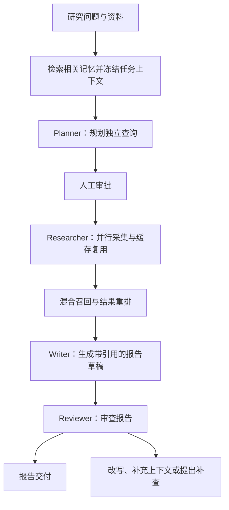

# Research Agent

基于 Python、LangGraph、SQLite 和 Qdrant 构建的本地研究助手。

项目围绕“规划、审批、采集、检索、写作、审查、交付”组织研究流程，支持多 Agent 协作、本地文档研究、上下文压缩、长期记忆和中断恢复。

统一启动入口为 `main.py`，支持浏览器研究工作台和命令行研究、管理操作。

## 核心功能

| 功能 | 说明 |
|---|---|
| 浏览器工作台 | 创建任务、审阅计划、批准或拒绝检索、恢复执行和阅读报告 |
| 多 Agent 协作 | Planner 规划任务，Researcher 采集资料，Reviewer 审查报告，通过结构化结果交接 |
| 并行采集 | 并行处理独立查询，数据库写入和调用额度管理由主线程完成 |
| 多来源研究 | 支持网页、arXiv 论文摘要、GitHub 公开仓库 README 和本地文档 |
| 本地 RAG | 文档解析、分块、向量化、Qdrant 存储、混合召回及结果重排 |
| 证据引用 | 保留证据编号、来源地址、文件名称、章节或页码 |
| 上下文压缩 | 按 Token 预算摘要、去重和筛选，保留任务目标、关键引用及未解决问题 |
| 长期记忆 | 保存用户偏好、研究主题和人工确认结论，支持跨任务复用 |
| 人工审批 | 初始查询和新增补查经过人工批准 |
| 中断恢复 | 保存工作流状态，恢复时复用已提交的采集与生成缓存 |
| 调用管理 | 查看模型和远程查询的逻辑调用量，调整任务额度 |
| 报告验收 | 检查审查结果、引用范围、来源覆盖及报告一致性 |
| 报告导出 | 导出报告、证据、验收结果和文件哈希清单 |

## 工作流程



补查涉及新查询时，会再次进入人工审批。

## 项目结构

```text
research-agent/
├── main.py                  # 应用入口
├── README.md                # 项目说明
├── requirements.txt         # Python 依赖
├── .env.example             # 环境配置模板
├── .gitignore
├── api/                     # FastAPI 接口与应用生命周期
│   └── app.py               # HTTP 接口与前端静态文件
├── frontend/                # React、TypeScript、Vite 浏览器界面
│   ├── package.json         # 前端命令和依赖
│   ├── package-lock.json    # 可重复安装的依赖锁文件
│   └── src/                 # 页面、API 客户端和界面测试
├── llm/                     # 模型客户端与请求配置
├── research/                # 研究工作流、检索、记忆及报告处理
│   ├── engine.py            # 研究引擎与已有任务规划
│   ├── web_service.py       # 网页持久任务队列、审批及恢复
│   ├── team.py              # Agent 角色与并行采集
│   ├── vector.py            # 文档解析、向量索引、融合及重排
│   ├── context.py           # Token 预算与上下文压缩
│   ├── knowledge.py         # 研究长期记忆
│   ├── runtime.py           # 任务锁、取消及失败记录
│   ├── management.py        # 调用额度及缓存管理
│   ├── generation.py        # 生成结果缓存
│   ├── recovery.py          # 采集缓存与恢复
│   ├── workflow.py          # LangGraph 工作流
│   ├── documents.py         # 文档及分块存储
│   ├── rag.py               # 分块与关键词检索
│   ├── sources.py           # 远程资料采集
│   ├── quality.py           # 报告规则验收
│   ├── export.py            # 报告导出
│   └── smoke.py             # 本地模型链路验证
├── agent/                   # 通用 Agent 组件
├── memory/                  # 会话记忆与记忆处理组件
├── tools/                   # 搜索、网页读取等工具
├── tests/                   # 自动化测试
├── data/                    # 运行数据与模型缓存
└── exports/                 # 报告导出目录
```

## 环境与安装

验证环境为 Windows 64 位、Python 3.13 和 PowerShell。

主要技术：

| 用途 | 技术 |
|---|---|
| 浏览器界面 | React、TypeScript、Vite |
| HTTP 服务 | FastAPI、Uvicorn |
| 工作流与状态恢复 | LangGraph、SQLite Checkpointer |
| 研究模型调用 | OpenAI Python SDK、兼容模型接口 |
| 网页采集 | Tavily、requests、BeautifulSoup |
| 向量化与重排 | FastEmbed |
| 向量存储 | Qdrant |
| 文档解析 | pypdf、python-docx |
| Token 估算 | tiktoken |
| 业务数据与长期记忆 | SQLite |

以下路径为示例，请替换成项目实际所在目录。

```powershell
Set-Location 'C:\path\to\research-agent'

if (-not (Test-Path -LiteralPath '.venv\Scripts\python.exe')) {
    py -3.13 -m venv .venv
}

.\.venv\Scripts\python.exe -m pip install -r requirements.txt
if ($LASTEXITCODE -ne 0) { throw '依赖安装失败' }

.\.venv\Scripts\python.exe -m pip check
if ($LASTEXITCODE -ne 0) { throw '依赖检查失败' }
```

后续命令均在项目根目录执行。

## 环境配置

首次使用时，从模板创建 `.env`：

```powershell
if (-not (Test-Path -LiteralPath '.env')) {
    Copy-Item -LiteralPath '.env.example' -Destination '.env'
}
```

填写模型和搜索服务配置：

```dotenv
DEEPSEEK_API_KEY=your-deepseek-api-key
DEEPSEEK_BASE_URL=https://api.deepseek.com
DEEPSEEK_MODEL=your-available-model
DEEPSEEK_MEMORY_MODEL=your-available-model

LLM_TIMEOUT_SECONDS=30
LLM_MAX_RETRIES=1
LLM_MAX_OUTPUT_TOKENS=4096

TAVILY_API_KEY=your-tavily-api-key
GITHUB_TOKEN=
```

| 配置项 | 说明 |
|---|---|
| DEEPSEEK_API_KEY | 研究模型调用凭据 |
| DEEPSEEK_BASE_URL | 模型接口地址 |
| DEEPSEEK_MODEL | 账号实际可用的研究模型名称 |
| DEEPSEEK_MEMORY_MODEL | 记忆组件使用的模型；删除该变量时继承主模型，设置时不能留空 |
| LLM_TIMEOUT_SECONDS | 模型请求超时，默认 30 秒 |
| LLM_MAX_RETRIES | 模型客户端重试次数，默认 1 |
| LLM_MAX_OUTPUT_TOKENS | 单次请求的最大输出 Token，默认 4096 |
| TAVILY_API_KEY | 网页搜索凭据 |
| GITHUB_TOKEN | 可选，用于访问 GitHub 公开仓库资料 |

进程中已有的同名环境变量优先于 `.env`。修改配置后应重新启动程序。

状态查看、额度管理、取消和记忆管理不需要研究模型 Key。模型预热和本地检索链路验证也不调用研究模型。

## 模型预热与链路验证

### 预热本地模型

```powershell
.\.venv\Scripts\python.exe -B main.py --warmup
if ($LASTEXITCODE -ne 0) { throw '模型预热失败' }
```

默认模型：

| 用途 | 模型或编码 |
|---|---|
| Embedding | BAAI/bge-small-zh-v1.5 |
| Reranker | BAAI/bge-reranker-v2-m3-int8 |
| Tokenizer | cl100k_base |

首次预热会下载模型和词表。

模型默认缓存到 `data/models`，词表缓存到 `data/models/tiktoken`。

可以通过 `--models` 调整缓存目录；进程环境变量 `TIKTOKEN_CACHE_DIR` 可以单独指定词表缓存目录。

### 验证本地检索链路

```powershell
.\.venv\Scripts\python.exe -B -m research.smoke
if ($LASTEXITCODE -ne 0) { throw '本地检索验证失败' }
```

该命令使用临时文档和数据库，验证：

- 文档导入与分块。
- 真实 Embedding 和 Reranker。
- Qdrant 索引写入、查询及重开。
- 证据编号关联。
- 上下文预算计算。

临时测试数据在运行结束后清理，不读取现有业务数据库。

## 浏览器研究工作台

工作台使用本地 `default` 研究档案，显示由网页创建的研究任务。命令行创建的历史任务继续通过命令行管理。

### 安装并构建界面

在 Python 依赖安装完成后，安装带 npm 的 Node.js，版本需为 22.12 或更高。

```powershell
Set-Location 'C:\path\to\research-agent'
node --version
npm.cmd --version

Set-Location '.\frontend'
npm.cmd ci
if ($LASTEXITCODE -ne 0) { throw '前端依赖安装失败' }
npm.cmd test
if ($LASTEXITCODE -ne 0) { throw '前端测试失败' }
npm.cmd run build
if ($LASTEXITCODE -ne 0) { throw '前端构建失败' }
Set-Location '..'
```

`package-lock.json` 应与 `package.json` 一同保留。构建产物保存在 `frontend/dist`。

### 启动工作台

确认根目录 `.env` 中的模型与搜索配置已填写，按“模型预热与链路验证”完成首次模型下载后，执行：

```powershell
.\.venv\Scripts\python.exe -B main.py --web
```

打开 <http://127.0.0.1:8000>。构建后的页面和 API 由同一个 Python 服务提供，不需要另开前端进程。

端口被占用时：

```powershell
.\.venv\Scripts\python.exe -B main.py --web --web-port 8010
```

此时打开 <http://127.0.0.1:8010>。HTTP 接口说明位于同一端口的 `/docs`。

操作流程：

1. 输入研究问题并创建任务，后台生成检索计划。
2. 查看查询来源与内容，选择“批准并继续”或“拒绝本次检索”。
3. 查看采集、检索、写作和审查阶段，以及已记录的逻辑调用用量。
4. 需要补查时，再次审批；执行结束后阅读带引用的 Markdown 报告。
5. 刷新或重新打开页面后，从任务列表继续查看；出现“恢复任务”时，确认状态后手动恢复。

页面每轮请求完成后约 2 秒再次读取状态，展示已保存的执行阶段。关闭浏览器不会关闭后台服务；服务停止期间任务不会执行，重新启动后，先前正在执行的任务会显示中断提示。已排队的操作会继续处理。

模型和搜索凭据只配置在后端 `.env`，前端通过本地 API 操作任务。服务监听 `127.0.0.1`，同一数据库只启动一个 Web 服务进程。

### 前端开发

先在一个终端启动 Python 服务：

```powershell
Set-Location 'C:\path\to\research-agent'
.\.venv\Scripts\python.exe -B main.py --web
```

再在另一个终端启动 Vite：

```powershell
Set-Location 'C:\path\to\research-agent\frontend'
npm.cmd run dev
```

打开 <http://127.0.0.1:5173>。开发服务器把 `/api` 请求代理到 `127.0.0.1:8000`；开发时保留后端默认端口。

修改前端后，重新执行 `npm.cmd run build`，再启动 Python 服务即可使用新构建的界面。

## 创建研究任务

查看命令帮助：

```powershell
.\.venv\Scripts\python.exe -B main.py --help
```

创建研究任务：

```powershell
.\.venv\Scripts\python.exe -B main.py `
    --question "研究 Agent 中断恢复的实现方式，并引用相关资料"
```

程序完成规划后，会显示任务 ID 和待执行查询。

审批输入：

| 输入 | 行为 |
|---|---|
| yes | 批准执行 |
| no | 拒绝执行 |
| 其他内容 | 暂停并保存已提交状态 |

主入口使用参数选择操作模式，启动研究时需要提供 `--question` 或其他操作参数。

## 本地文档研究

支持 UTF-8 TXT、Markdown、文本 PDF 和 DOCX。

```powershell
.\.venv\Scripts\python.exe -B main.py `
    --question "根据文档说明项目的记忆确认流程与恢复机制，并引用依据" `
    --file 'C:\path\to\research-agent\README.md' `
    --local-only
```

多个文件可以重复指定：

```powershell
.\.venv\Scripts\python.exe -B main.py `
    --question "比较两份文档的研究结论" `
    --file 'C:\path\to\documents\document-a.md' `
    --file 'C:\path\to\documents\document-b.pdf' `
    --local-only
```

`--local-only` 表示只从已导入的本地资料中检索。规划、写作和审查仍通过研究模型完成。

文件在规划前保存为任务所属的文本快照。之后修改原文件不会改变已有任务中的快照。

来源信息包括：

- 文件名称和原路径。
- Markdown 或 DOCX 章节。
- PDF 页码。
- 文件哈希。
- 文档及分块编号。

## 任务管理

每次调用选择一个操作模式。

| 参数 | 功能 |
|---|---|
| `--question "问题"` | 创建研究任务 |
| `--resume ID` | 启动计划或恢复任务 |
| `--state ID` | 查看状态、checkpoint 和恢复条件 |
| `--cancel ID` | 取消可取消的任务 |
| `--results ID` | 查看结构化采集结果 |
| `--usage ID` | 查看调用量和额度 |
| `--limits ID MODEL QUERY` | 调整任务调用额度 |
| `--memory ACTION KIND KEY VALUE` | 管理研究记忆 |
| `--memories "查询"` | 检索研究记忆 |
| `--confirm ID KEY TEXT` | 人工确认研究结论 |
| `--warmup` | 预热本地模型及词表 |

常用命令：

```powershell
$taskId = 'your-task-id'

.\.venv\Scripts\python.exe -B main.py --state $taskId
.\.venv\Scripts\python.exe -B main.py --resume $taskId
.\.venv\Scripts\python.exe -B main.py --results $taskId
.\.venv\Scripts\python.exe -B main.py --usage $taskId
.\.venv\Scripts\python.exe -B main.py --limits $taskId 16 10
.\.venv\Scripts\python.exe -B main.py --cancel $taskId
```

通用配置：

| 参数 | 默认值或用途 |
|---|---|
| `--user` | 本地研究档案，默认 default |
| `--db` | 业务数据库，默认 data/memory.db |
| `--index` | 向量索引目录，默认 data/qdrant |
| `--models` | 模型缓存目录，默认 data/models |
| `--context-limit` | 上下文总预算，默认 16000 |
| `--file` | 新任务使用的本地文件，可重复指定 |
| `--local-only` | 新任务仅使用本地资料 |
| `--evidence` | 人工确认结论使用的证据编号 |

主入口退出码：

| 退出码 | 含义 |
|---|---|
| 0 | 命令处理完成 |
| 1 | 执行错误 |
| 2 | 参数错误 |
| 130 | 输入中断 |

任务是否完成及报告是否通过验收，应结合任务状态和验收结果判断。

## 中断恢复与调用管理

研究流程分别保存工作流状态、采集缓存和生成缓存。

恢复任务时：

- 复用已提交的成功采集结果。
- 复用已通过校验的 Writer 和 Reviewer 生成结果。
- 继续执行 checkpoint 指向的待处理节点。
- 保留原任务的审批状态和冻结记忆。

暂停后可以先查看状态，再恢复：

```powershell
.\.venv\Scripts\python.exe -B main.py --state 'your-task-id'
.\.venv\Scripts\python.exe -B main.py --resume 'your-task-id'
```

使用 `--state` 返回的 `resume_allowed` 判断任务是否可以恢复。规划失败且没有可恢复 checkpoint 的任务，需要重新创建。

取消会写入持久化标记，已取消任务不能继续恢复。

任务锁覆盖执行和审批过程。锁文件会保留，文件存在不代表任务仍在运行。

默认逻辑调用额度：

| 类型 | 默认值 |
|---|---|
| 规划、写作和审查模型调用 | 12 次 |
| 远程采集查询 | 8 次 |

本地检索不占远程采集次数。失败预占不退还，缓存命中不重复计量。

SDK 内部重试和网页正文等内部请求不单独计数，逻辑额度与实际 Token 费用分别管理。

## 混合检索与上下文管理

检索流程：

```text
文档解析与分块
    → FastEmbed 向量化
    → Qdrant 按任务过滤
    → BM25 与向量排名进行 RRF 融合
    → CrossEncoder 重排
    → 按来源覆盖选择证据
```

SQLite 保存文档文本和分块，Qdrant 保存可重建的检索索引。

上下文处理包括：

- 保留任务目标、关键事实和未解决问题。
- 为必需证据引用优先分配预算。
- 对长证据和工具返回进行抽取摘要。
- 保留证据编号、来源及摘要对应的字符范围。
- 保留工具调用与返回的配对关系。
- 去除重复内容，筛选相关历史和记忆。

默认总预算为 16000，输出预留等于 `LLM_MAX_OUTPUT_TOKENS`。

调整预算：

```powershell
.\.venv\Scripts\python.exe -B main.py `
    --resume 'your-task-id' `
    --context-limit 24000
```

Token 数使用 tiktoken 进行本地估算。强制保留的内容超过预算时，程序会明确报错。

更改模型请求、检索配置或上下文预算可能使生成缓存失效，需要重新生成结果。

## 长期记忆

研究记忆存储在 SQLite 的 `research_knowledge` 表中。

| 类型 | 内容 |
|---|---|
| preference | 用户偏好，通过命令维护 |
| topic | 研究主题，规划成功后自动保存 |
| conclusion | 人工确认的研究结论 |

### 记忆操作

新增偏好：

```powershell
.\.venv\Scripts\python.exe -B main.py `
    --memory ADD preference style "优先中文，简明并附来源"
```

更新偏好：

```powershell
.\.venv\Scripts\python.exe -B main.py `
    --memory UPDATE preference style "详细解释实现取舍"
```

保留原值：

```powershell
.\.venv\Scripts\python.exe -B main.py `
    --memory KEEP preference style "-"
```

检索记忆：

```powershell
.\.venv\Scripts\python.exe -B main.py `
    --memories "研究方向"
```

删除偏好：

```powershell
.\.venv\Scripts\python.exe -B main.py `
    --memory DELETE preference style "-"
```

ADD 用于不存在的键，已有键使用 UPDATE。KEEP 和 DELETE 的最后一项使用占位值。

记忆根据关键词相关性检索。每项任务在规划前冻结命中的记忆；后续更新只影响新任务，恢复中的任务继续使用冻结值。

### 人工确认结论

```powershell
.\.venv\Scripts\python.exe -B main.py `
    --confirm 'your-task-id' conclusion_key "填写人工核验后的结论" `
    --evidence D1C1 D1C2
```

请使用 completed 任务的真实 ID 和证据编号。任务应属于当前研究档案，引用证据应属于该任务。

Reviewer 通过不会自动保存人工确认结论。历史结论作为研究背景，新报告仍使用本轮资料建立证据关联。

### 研究档案

使用 `--user` 为不同研究档案组织任务与记忆：

```powershell
.\.venv\Scripts\python.exe -B main.py `
    --user alice `
    --question "你的研究问题"

.\.venv\Scripts\python.exe -B main.py `
    --user alice `
    --resume 'your-task-id'
```

恢复任务时使用创建任务的同一档案。

## 报告验收

```powershell
$taskId = 'your-task-id'

.\.venv\Scripts\python.exe -B -m research.quality `
    --db 'data/memory.db' `
    --task $taskId
```

验收内容包括：

- 最新轮审查结果。
- 引用编号及其范围。
- 计划要求的来源覆盖。
- 正文长度与结构。
- 报告与审查快照的一致性。

正文长度按 Python 字符数计算，不包含标题和参考来源。

退出码：

| 退出码 | 含义 |
|---|---|
| 0 | 规则通过 |
| 1 | 规则未通过 |
| 2 | 读取或参数错误 |

## 报告导出

导出 completed 且通过规则验收的任务：

```powershell
New-Item -ItemType Directory -Path 'exports' -Force | Out-Null

$taskId = 'your-task-id'

.\.venv\Scripts\python.exe -B -m research.export `
    --db 'data/memory.db' `
    --task $taskId `
    --output "exports/report-$taskId.zip"
```

输出路径应指向尚不存在的 ZIP 文件。

保存其他终态任务的快照：

```powershell
.\.venv\Scripts\python.exe -B -m research.export `
    --db 'data/memory.db' `
    --task $taskId `
    --output "exports/snapshot-$taskId.zip" `
    --snapshot
```

快照模式支持 completed、partial、cancelled 和 failed 等终态。

导出包内容：

| 文件 | 内容 |
|---|---|
| report.md | 报告、任务状态和验收说明 |
| evidence.json | 任务、审查记录、已保存分块及来源元数据 |
| quality.json | 同一业务快照的规则验收结果 |
| manifest.json | 导出信息和三个数据文件的 SHA256 |

导出退出码：

| 退出码 | 含义 |
|---|---|
| 0 | 导出成功 |
| 1 | 状态或验收拒绝 |
| 2 | 读取、参数或文件写入错误 |

## 自动化测试

执行全部测试：

```powershell
.\.venv\Scripts\python.exe -B -m unittest discover -s tests -p "test_*.py" -v
if ($LASTEXITCODE -ne 0) { throw '测试失败' }
```

测试覆盖：

| 范围 | 验证内容 |
|---|---|
| 任务控制 | 跨进程互斥、取消、异常退出和状态持久化 |
| 调用管理 | 额度预占、额度调整和缓存命中 |
| 工作流 | 审批、补查、来源覆盖和中断恢复 |
| 上下文 | Token 预算、关键引用、工具配对和来源保留 |
| 长期记忆 | 四类操作、档案隔离、人工确认和跨连接持久化 |
| 并行采集 | 并发执行、主线程落库和失败重试 |
| 混合检索 | 增量索引、融合、重排及异常数据校验 |
| 文档解析 | TXT、Markdown、文本 PDF 和 DOCX |
| 报告处理 | 规则验收、快照、哈希和并发发布 |
| 命令行 | 无模型凭据和词表时的运维操作 |
| Web API | 创建幂等、审批 checkpoint 校验、持久队列、重启恢复及工作线程互斥 |
| 浏览器界面 | 提交重试、轮询更新、审批冲突、任务切换及 Markdown 展示 |

前端测试在 `frontend` 目录执行 `npm.cmd test`；构建检查执行 `npm.cmd run build`。

日常自动化测试中的模型与采集接口使用测试夹具；本地依赖集成测试使用真实 Qdrant 和文档解析器。

真实模型检索链路通过以下命令单独验证：

```powershell
.\.venv\Scripts\python.exe -B -m research.smoke
```

## 数据存储与备份

默认数据目录：

```text
data/
├── memory.db                 # 业务数据、研究记忆及 web_jobs 持久队列
├── research_checkpoints.db   # 工作流恢复状态
├── models/                   # 模型及词表缓存
└── qdrant/                   # 向量索引
```

使用 `--db` 指定其他业务数据库时，checkpoint 保存到该数据库同目录的 `research_checkpoints.db`。不同独立实例使用不同数据目录。

备份前退出相关进程，同时备份业务数据库和 checkpoint。

文档文本快照存储在业务数据库中；模型可重新下载，向量索引可根据文档快照重建。

`.env`、虚拟环境、运行数据库、默认模型缓存、默认向量索引及默认导出目录由 `.gitignore` 管理。使用自定义存储目录时，应同步配置相应的忽略规则。
前端依赖 `frontend/node_modules`、构建产物 `frontend/dist` 和覆盖率目录由 `.gitignore` 管理。
